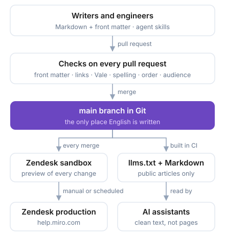

Miro's Help Center has nearly 1,000 English articles on Zendesk Guide, and the localization team translates them into seven more languages. Until September 2026, writers edited articles in Zendesk's web editor. Now they write Markdown in Git, every change goes through a pull request with automated checks, and a pipeline publishes to Zendesk. Readers saw no change: the site, the URLs and the translations stayed where they were.

I proposed the project, led it, and built most of the tooling, largely with AI coding agents.

## At a glance

- **Scale:** about 1,000 articles in 7 categories, including articles that only admins or specific customer groups can see.
- **People:** a small writing team that was new to Git, and engineers who now open doc fixes themselves.
- **Stack:** Markdown, Git, GitHub Actions, Python, Vale and the Zendesk Guide API.
- **Switch-over:** September 2026, after months of publishing to a sandbox and a parity check against the live site.

## Why move

The web editor had worked for years, but its limits grew as the product moved faster:

- **No review.** A change went live when someone pressed Publish. There was no diff, and nobody else saw it first.
- **No useful history.** Finding out who changed a sentence, and why, meant guessing.
- **No bulk changes.** Renaming a feature across dozens of articles meant opening each one.
- **No structure for machines.** AI assistants and search engines increasingly read the Help Center before people do, and they were reading rendered HTML.

Docs-as-code fixes all four with tools engineers already trust. Git keeps the history, pull requests give review, CI runs the checks, and Markdown is plain text that both people and AI agents can read.

## Constraints

- **Zendesk stays the website.** Readers, search rankings, URLs and the in-product help widget all depend on it. Git became the source, and Zendesk became the publishing target.
- **Translations belong to another team.** The localization team owns seven languages directly in Zendesk, and their tooling reacts to our publishes. The pipeline only ever writes English.
- **Some articles are restricted.** Admin-only and segment-only articles must never leak into public output, including the files written for AI agents.
- **Nobody should notice.** No broken links, lost images or reordered sections on switch-over day.
- **Writers, not engineers.** Everything had to work for writers who were new to Git.

## What I built

### A Markdown format with a contract

Each article is one Markdown file. Its front matter carries everything Zendesk needs: the title, position, audience and a permanent identity key. That key, not Zendesk's article ID, links a file to its live page, so a new article can be reviewed and merged before Zendesk has ever seen it. Callouts, tabs and expandable sections use simple fenced blocks, and the authoring handbook documents each one.

### How do you publish Markdown to Zendesk without losing anything?

The publisher turns Markdown into Zendesk's HTML and keeps the whole tree in step with Git: categories, sections, order, permissions and images. Deleting a file archives the article rather than destroying it, so it can be restored.

Two checks keep the conversion honest:

- **Round trip.** Every live article goes through the export converter and back through the publish converter. The check counts features on both ends, such as lists, callouts, accordions and images. A count that drops is content the switch would silently lose, and CI fails if losses grow.
- **Parity.** A full publish runs against production through a client that records writes instead of sending them. Every request goes through one method that refuses anything but a read. The report lists every change a reader would see.

### Checks on every pull request

CI checks front matter, links, Vale style rules, spelling, article order and audience gating on every pull request, so reviewers can spend their time on the content. That's more than 20 workflows and 100+ test files. Every third-party Action is pinned to a commit SHA: a docs pipeline that publishes to production deserves the same supply-chain care as product code.

### How do you keep restricted articles out of llms.txt?

The same source produces `llms.txt` and per-area Markdown bundles, so AI assistants can read the Help Center as clean text instead of scraping pages. The bundles contain public articles only. The obvious shortcut, reusing the list of audiences the site publishes to, would have put a couple of hundred admin-only articles into a public file. So the filter is stricter than that, and a separate CI check re-reads the built files to confirm it.

### AI tooling for the writing team

I wrote eight agent skills for the fiddly parts of the job: scaffolding an article or section, moving or retiring one without breaking links, reordering a section, and checking formatting before a pull request. A shared `AGENTS.md` gives Claude Code, Cursor and Codex the same rules, whichever tool a writer prefers. The authoring handbook and a Git guide for writers cover everything the skills don't.

### Ownership

Each article is linked to the engineering team that owns its feature in Miro's service catalog. When a feature changes, there's a named team to ask, and outdated docs have an owner.

## How do you switch publishing without readers noticing?

I treated the switch like a production release:

- **Rehearse on a sandbox.** Every merge published to a Zendesk sandbox for months before production.
- **Measure, don't estimate.** The parity report gated the switch. At one point we predicted a fix would cut the visible differences from 260 to about 160. The re-run showed 260 again, because the estimate had counted at the wrong end. From then on, only measured numbers counted.
- **Keep a parachute.** The old sync stayed intact as the rollback. The first production runs only updated articles and never deleted any, so a rollback would never have to undo anything.
- **Release on a schedule.** A writer can comment `/publish on 2026-09-30 09:00 UTC` on a pull request. At that time it merges and publishes.

The first production publish ran on 8 September 2026. Since then the pipeline has published to production 95 times, about a dozen times a week, with one failed run.

## Results

- Git is the only place English articles are written. Every change has an author, a reviewer and a diff.
- Writers have merged more than 260 pull requests, and engineers have started opening doc fixes themselves.
- Restricted articles can't reach public output: the check runs on every pull request.
- AI assistants get clean, public-only Markdown from the same source as the site.
- The content no longer depends on Zendesk. If the Help Center moves to another platform, the articles move as they are.

## What I'd do differently

- **Change the source before the platform.** We first built a Docusaurus site from the Markdown. It was a useful preview, but moving the source of truth didn't need a new site, and keeping a second build in step cost time until we retired it.
- **Settle identity first.** Matching files to pages by Zendesk article ID broke for new articles, which have no ID until they're published. A permanent key in each file fixed it, but changing identity halfway through is expensive.
- **Retire the old path sooner.** For a while, two pipelines published the same content in different ways, and people and agents both mixed them up.
- **Measure from day one.** The parity report came late. If it had existed from the start, every conversion fix would have had a number attached.
