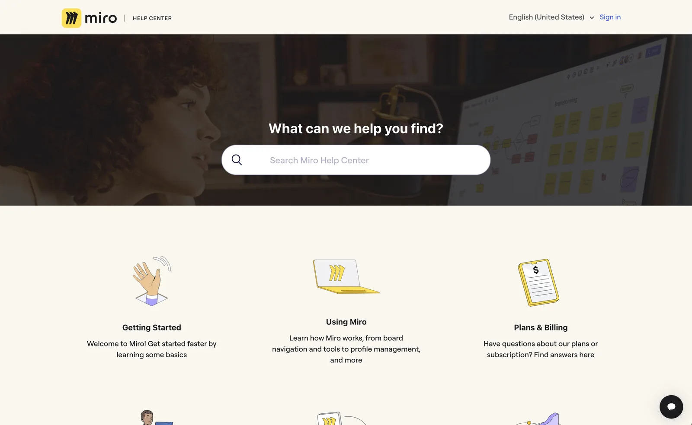
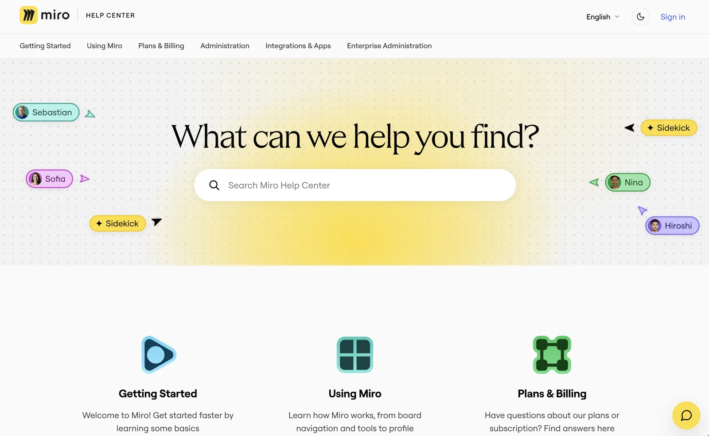
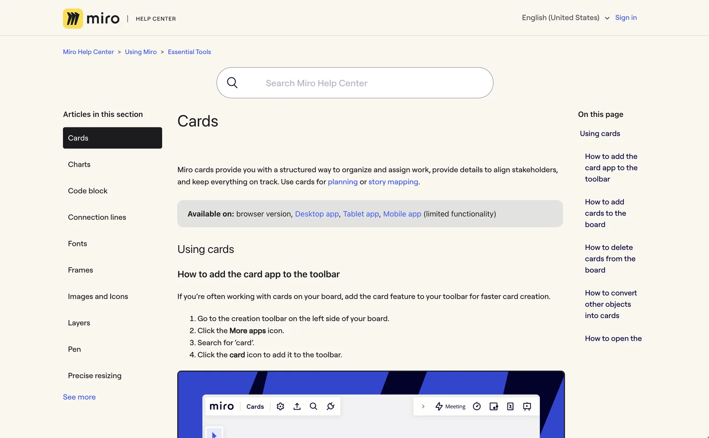
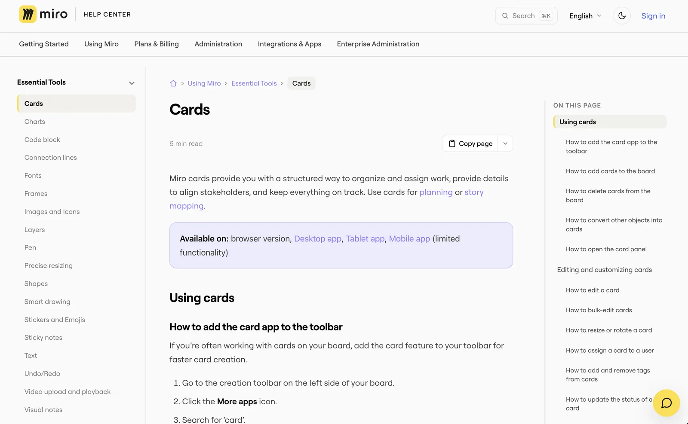
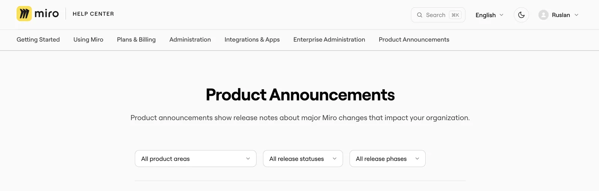

In October 2026 the Miro Help Center switched to a new theme. The same 1,000 articles stayed at the same URLs, but readers got a new way to find and read them. I led the redesign and built the theme: 27 versions between July and October, each previewed on a sandbox before it went near production.

This is the second half of a bigger change. The [first half](help-center-docs-as-code.html) moved the content itself into Git.

## At a glance

- **Scope:** 11 of the theme's 22 Zendesk templates rebuilt, plus its CSS and JavaScript.
- **Languages:** English and seven translations. Every new piece of interface text can be translated.
- **Shipped:** version 2.0.27 replaced 1.4.17 on help.miro.com in October 2026.
- **Nothing dropped:** every redirect, support-widget rule and tracking hook from the old theme carried over.

## What wasn't working

- **Getting around.** There was no top-level navigation. The sidebar listed only the current section, with a "See more" link, so moving to another area of the product meant going back to the home page.
- **Search took over every page.** A large search box sat above every article, pushing the content down, and it moved to a different place on category pages.
- **One look, hard-coded.** The stylesheet had a single CSS variable. Colours were written out by hand across 6,500 lines, so there was no practical way to offer dark mode.
- **Mixed languages.** About 35 pieces of interface text were hard-coded in English, plus the messages in the JavaScript. Readers of a translated page still saw English labels.
- **Feedback went nowhere.** Answers to "Was this helpful?" had been silently lost since 2022, and comments containing `&`, `#` or `+` were cut off.

<figure>

<figcaption>Before: a photo hero and no way to reach a category except through the tiles.</figcaption>
</figure>

<figure>

<figcaption>After: every category one click away from any page, and a home page that looks like Miro.</figcaption>
</figure>

## What changed for readers

### Finding the right article

Every page now has the full list of categories across the top. The sidebar shows the whole category as a tree that readers can expand and collapse, with the current article highlighted and its group already open. Breadcrumbs show the full path, starting from a home icon. The "On this page" list stays in view and highlights the heading you're reading, and every heading has its own link, so support agents can send a customer to the exact step.

<figure>

<figcaption>Before: the search box sits above every article, and the sidebar shows one section.</figcaption>
</figure>

<figure>

<figcaption>After: the article starts at the top, with navigation, reading time and a Copy page menu around it.</figcaption>
</figure>

### Searching from anywhere

Search moved into a compact box in the header. It opens a full-screen search with ⌘K or Ctrl+K from any page. An empty search shows your recent searches, the first result is selected so Enter opens it, and each result shows which section it comes from.

### Reading comfortably

- **Dark mode.** One toggle in the header. The choice is applied before the page draws, so there's no white flash.
- **Reading time.** Each article shows an estimate. For Japanese and Chinese it counts characters instead of words.
- **Wide tables** scroll sideways instead of squeezing their columns.
- **Accessibility.** Visible focus styles, far more labelled controls (ARIA attributes went from 45 to 175), and no animation for readers who've turned motion off.

### How do you hand a help article to an AI assistant?

Many readers now paste help articles into ChatGPT or Claude. Every article has a **Copy page** button that copies it as clean Markdown. Its menu also opens the article in ChatGPT, Claude or Gemini with a ready-made prompt. Zendesk can't serve Markdown itself, so the theme converts the page in the browser. For agents that read the whole Help Center, the [docs-as-code pipeline](help-center-docs-as-code.html) publishes `llms.txt` and Markdown bundles.

### Product announcements

The release-notes category already had filters by product area, status and phase. The redesign translated their labels, added page numbers and gave the status badges colours that work in dark mode.

<figure>

<figcaption>Release notes with filters, now translated.</figcaption>
</figure>

## In every language

The theme added 82 new translation keys, agreed with the localization team so they fit the team's existing workflow. Messages written by the JavaScript go through a small helper that reads the translated text from the page and fills in values like counts. If a translation doesn't exist yet, the reader sees English rather than a blank. A handful of labels are still English only, and they're on the list for the next release.

## How do you ship a theme redesign without breaking a live site?

- **Sandbox first.** Every change went to a sandbox Help Center first. The production build is made from the sandbox one and differs only in its name and a few IDs, so what I previewed is what shipped.
- **One version per change.** Each new behaviour got its own version number, so the previous build was always a clean rollback.
- **Merge the live site in.** The redesign started from an older copy of the live theme. Before production, I merged in everything the live theme had gained since, including redirects, support-widget rules, chat and table styles.
- **Design tokens.** The stylesheet went from 1 CSS variable to 90. Colours are defined once, and dark mode swaps the set.
- **Navigation that respects permissions.** The menus are built from the Help Center's API and cached for each audience and language separately, so a reader never sees an article that's meant for someone else.
- **Feedback restored.** "Was this helpful?" answers reach the team again, with the full comment.

## Trade-offs and what's next

- **It's heavier.** The CSS went from 127 KB to 247 KB and the JavaScript from 21 KB to 82 KB. The navigation is built in the browser, so it needs JavaScript, and a reader's first visit fetches the article list in several requests before the cache takes over.
- **The CSS grew in layers.** Later rounds of changes were added as overrides on top of earlier ones. Folding them into the tokens is the next clean-up.
- **Accessibility isn't finished.** The search overlay needs proper dialog behaviour and focus handling, the "Was this helpful?" answers should be real buttons, and dark mode should follow the reader's system setting.
- **Copy page has limits.** The Markdown conversion flattens tables and nested lists.
